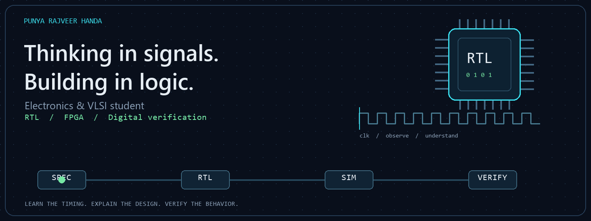

  

<h1 align="center">Hi, I'm Punya.</h1>

<strong>Electronics & VLSI student · Thapar Institute of Engineering and Technology</strong>

Learning to turn protocol diagrams into digital designs I can explain and verify.

---

### On my workbench

**[AHB → APB Bridge](https://github.com/PunyaRajveerHanda/ahb-apb-bridge-learning)**  
An ongoing study and design project targeting full AMBA 2 AHB with an APB3 peripheral interface.

- Working through address/data pipelining, bursts, wait states and response handling.
- Recording handwritten timing diagrams, daily journals and references.
- Building towards a defined bridge interface, RTL and simulation-based verification.

**Current stage:** protocol study and worked timing examples. Bridge RTL and simulation are upcoming milestones.

### Areas I'm developing

| Digital design | Verification | FPGA & workflow |
| :--- | :--- | :--- |
| SystemVerilog · FSMs · FIFOs | Python · cocotb · timing analysis | Vivado · Ubuntu · Git |
| AMBA AHB / APB | Testbenches · scoreboards | Resource-aware hardware design |

These are areas of hands-on learning and project work; each repository documents its own validation and limitations.

### How I work

**Understand the protocol → draw the timing → define the behavior → implement → verify.**

I'm interested in digital design, FPGA systems and hardware that does useful work within practical resource constraints.

Small steps. Clear waveforms. Designs backed by evidence.

